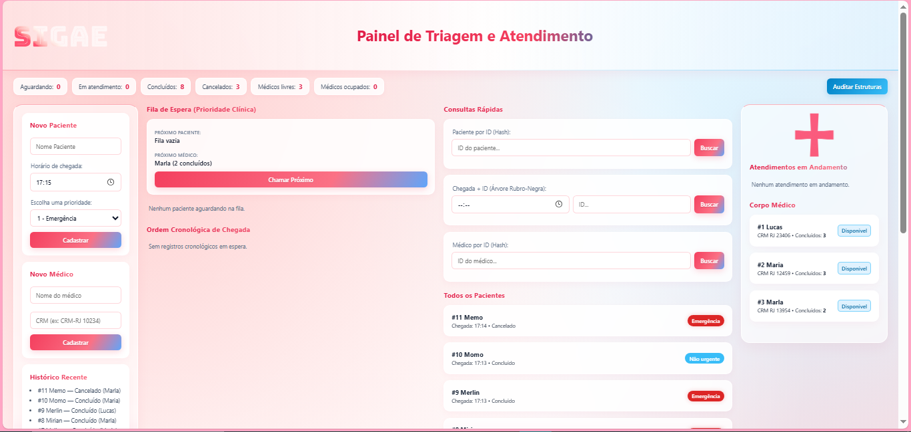

# SIGAE WEB — Sistema Inteligente de Gerenciamento de Atendimentos de Emergência

Aplicação web desenvolvida para a disciplina de Estrutura de Dados Avançados (Curso de Engenharia de Software — Universidade de Vassouras). O sistema simula a rotina de triagem e pronto-atendimento hospitalar utilizando implementações autorais de **Tabela Hash**, **Árvore Rubro-Negra** e **Min-Heap Binário**, sem o uso de estruturas equivalentes nativas (`dict`, `heapq` ou bibliotecas prontas de árvores) para indexação.

Todos os dados de pacientes e registros médicos utilizados na aplicação são estritamente fictícios e destinados exclusivamente à simulação acadêmica.

## Integrantes do Grupo

- João Victor Elizeu Silva
- Raissa Oliveira Rosa
- Thalles Cruz do Nascimento

---

## Painel da Aplicação



---

## Arquitetura e Estruturas de Dados Implementadas

O projeto é organizado em módulos independentes no Django, separando as estruturas de dados puras das regras de domínio e da persistência relacional:

| Módulo / Estrutura | Responsabilidade no Sistema | Complexidade Principal |
| :--- | :--- | :--- |
| `tabela_hash/hash_table.py` | Indexação de pacientes, médicos e atendimentos por ID único. Função modular (`ID % capacidade`), tratamento de colisões por encadeamento externo (`_HashNode`) e redimensionamento automático (`_rehash`) para o próximo número primo quando o fator de carga ultrapassa `0.75`. | Inserção, busca e remoção em `O(1)` médio; redimensionamento em `O(n)` (`O(1)` amortizado). |
| `rubro_negra/tree.py` | Índice cronológico dos pacientes em espera (`Aguardando`) ordenado pela chave composta `(arrival_minutes, id)`. Implementa inserção, remoção, busca exata, percurso em ordem (`inorder`), recoloração, rotações à esquerda/direita e validação das 5 propriedades Rubro-Negras. | Inserção, busca e remoção em `O(log n)`; listagem cronológica em `O(n)`. |
| `heap/min_heap.py` | Duas filas de prioridades independentes sobre vetor (`pai = (i - 1) // 2`): **1) Heap de Pacientes** ordenado por `(priority, arrival_minutes, id)` e **2) Heap de Médicos Disponíveis** ordenado por `(completed_count, last_assigned_seq, id)`. Utiliza ponteiros intrusivos (`heap_index`) nos objetos de domínio para reclassificação e remoção arbitrária sem varredura linear e sem `dict` auxiliar. | Consulta ao topo em `O(1)`; inserção, extração e reclassificação em `O(log n)`. |
| `atendimento/engine.py` | Orquestrador transacional em memória (`SigaeEngine`) com rollback atômico entre as estruturas, trava de chamada sem médico disponível, controle de estados e auditoria cruzada (`validate_all`). | Validação integral em `O(n)`. |
| `atendimento/services.py` | Sincronização thread-safe (`RLock` + `transaction.atomic`) entre o núcleo em memória e o banco de dados PostgreSQL, incluindo hidratação automática ao iniciar o servidor. | Persistência transacional. |

---

## Regras de Negócio Atendidas

1. **Triagem (Protocolo de Manchester)**: Classificação em 5 níveis (`1 - Emergência`, `2 - Muito urgente`, `3 - Urgente`, `4 - Pouco urgente`, `5 - Não urgente`). A prioridade clínica prevalece sobre o horário de chegada; empates são resolvidos pelo menor horário de chegada e, persistindo, pelo menor ID.
2. **Reclassificação sem Duplicação**: Alterar o risco de um paciente em espera atualiza imediatamente sua posição no `MinHeap` em `O(log n)`.
3. **Balanceamento da Equipe Médica**: Ao chamar o próximo paciente, o sistema seleciona automaticamente o médico `Disponível` com menor número de atendimentos concluídos. Em caso de empate, seleciona quem está há mais tempo sem receber paciente (`last_assigned_seq`) e, persistindo, o de menor ID.
4. **Proteção da Fila e Critério de Contagem**:
   - Caso não exista médico disponível, a chamada é recusada e o paciente permanece intacto na fila de espera.
   - A conclusão do atendimento incrementa `completed_count` em `+1` e devolve o médico ao Heap de disponíveis.
   - O cancelamento de um atendimento em andamento libera o médico para novas chamadas **sem incrementar** sua quantidade de atendimentos concluídos.

---

## Como Iniciar o Projeto

### Pré-requisitos
- **Com Docker (recomendado)**: Docker e Docker Compose instalados.
- **Execução local sem Docker**: Python 3.12+ e uma instância PostgreSQL ativa (ou ajuste para SQLite em ambiente local).

### Opção 1 — Inicialização com Docker Compose (Recomendada)

1. Na raiz do projeto, crie o arquivo `.env` com as variáveis de ambiente no formato `CHAVE=VALOR`:

```env
POSTGRES_USER=padrao
POSTGRES_PASSWORD=senha
POSTGRES_DB=db
SECRET_KEY='chave-secreta-desenvolvimento-sigae'
```

2. Construa os containers, aplique as migrações automaticamente e suba o servidor:

```bash
docker compose up --build
```

3. Acesse a interface web no navegador:

```text
http://localhost:8000
```

Para encerrar os containers:

```bash
docker compose down
```

### Opção 2 — Inicialização Local com Ambiente Virtual Python

1. Crie e ative o ambiente virtual e instale as dependências:

```bash
python3 -m venv venv
source venv/bin/activate
pip install -r requirements.txt
```

2. Defina as variáveis de ambiente para conexão com o banco PostgreSQL (ou exporte no terminal):

```bash
export SECRET_KEY="chave-secreta-desenvolvimento-sigae"
export POSTGRES_DB="db"
export POSTGRES_USER="padrao"
export POSTGRES_PASSWORD="senha"
```

3. Execute as migrações e inicie o servidor Django:

```bash
python manage.py migrate
python manage.py runserver
```

4. Acesse no navegador em `http://127.0.0.1:8000`.

---

## Execução dos Testes Automatizados e Saída Esperada

A suíte automatizada conta com **16 testes** cobrindo isoladamente a Tabela Hash (colisões, encadeamento, remoção e rehash), a Árvore Rubro-Negra (rotações, desempates, busca, remoção e invariantes), os Min-Heaps (prioridade clínica, reclassificação e balanceamento médico) e os cenários integrados da `SigaeEngine`.

### Comando para executar os testes

Via Docker (com os containers em execução):

```bash
docker compose exec django python manage.py test -v 2
```

Ou diretamente no ambiente virtual Python (com as variáveis do `.env` carregadas):

```bash
SECRET_KEY="teste" POSTGRES_DB="db" python manage.py test -v 2
```

### Saída dos testes

```text
Found 16 test(s).
Skipping setup of unused database(s): default.
System check identified no issues (0 silenced).
test_cancel_waiting_and_cancel_attendance_preserve_counts_and_invariants (atendimento.tests.SigaeEngineTests.test_cancel_waiting_and_cancel_attendance_preserve_counts_and_invariants) ... ok
test_priority_prevalence_reclassification_and_chronological_order (atendimento.tests.SigaeEngineTests.test_priority_prevalence_reclassification_and_chronological_order) ... ok
test_three_doctors_balanced_distribution_and_tiebreak (atendimento.tests.SigaeEngineTests.test_three_doctors_balanced_distribution_and_tiebreak) ... ok
test_validation_guards_bool_priority_and_duplicate_crm (atendimento.tests.SigaeEngineTests.test_validation_guards_bool_priority_and_duplicate_crm) ... ok
test_doctor_balancing_and_deterministic_tiebreak (heap.tests.MinHeapTests.test_doctor_balancing_and_deterministic_tiebreak) ... ok
test_patient_priority_and_tiebreakers (heap.tests.MinHeapTests.test_patient_priority_and_tiebreakers) ... ok
test_reclassify_patient_up_and_down (heap.tests.MinHeapTests.test_reclassify_patient_up_and_down) ... ok
test_remove_arbitrary_item_from_middle (heap.tests.MinHeapTests.test_remove_arbitrary_item_from_middle) ... ok
test_insert_ascending_triggers_rotations_and_keeps_invariants (rubro_negra.tests.RedBlackTreeTests.test_insert_ascending_triggers_rotations_and_keeps_invariants) ... ok
test_insert_descending_and_same_arrival_time_tiebreak_by_id (rubro_negra.tests.RedBlackTreeTests.test_insert_descending_and_same_arrival_time_tiebreak_by_id) ... ok
test_rejects_duplicate_insertion (rubro_negra.tests.RedBlackTreeTests.test_rejects_duplicate_insertion) ... ok
test_remove_root_leaves_and_internal_nodes_preserves_rb_properties (rubro_negra.tests.RedBlackTreeTests.test_remove_root_leaves_and_internal_nodes_preserves_rb_properties) ... ok
test_automatic_rehash_when_load_factor_exceeded (tabela_hash.tests.HashTableTests.test_automatic_rehash_when_load_factor_exceeded) ... ok
test_collision_chaining_and_middle_removal (tabela_hash.tests.HashTableTests.test_collision_chaining_and_middle_removal) ... ok
test_put_get_and_remove_patient (tabela_hash.tests.HashTableTests.test_put_get_and_remove_patient) ... ok
test_rejects_duplicate_key (tabela_hash.tests.HashTableTests.test_rejects_duplicate_key) ... ok

----------------------------------------------------------------------
Ran 16 tests in 0.002s

OK
```

---

## Estrutura de Diretórios

```text
sigae/
├── atendimento/          # Domínio, SigaeEngine, serviços transacionais, API REST e templates web
├── heap/                 # Implementação autoral do Min-Heap Binário e testes unitários
├── rubro_negra/          # Implementação autoral da Árvore Rubro-Negra e testes unitários
├── tabela_hash/          # Implementação autoral da Tabela Hash e testes unitários
├── sigae/                # Configurações do projeto Django e roteamento principal
├── docs/                 # Capturas de tela e diagramas do projeto
├── Dockerfile            # Imagem da aplicação web
├── compose.yml           # Orquestração dos serviços Django e PostgreSQL 16
├── requirements.txt      # Dependências Python
└── manage.py             # Utilitário de linha de comando do Django
```
